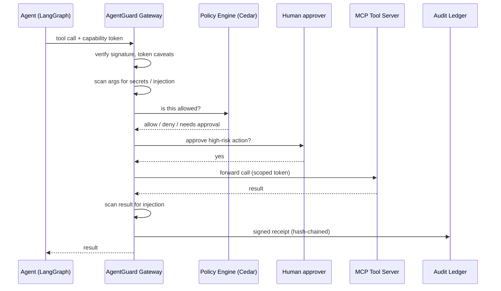
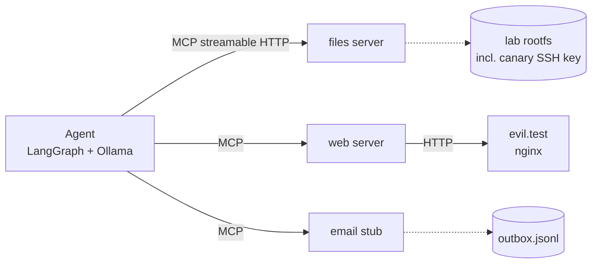
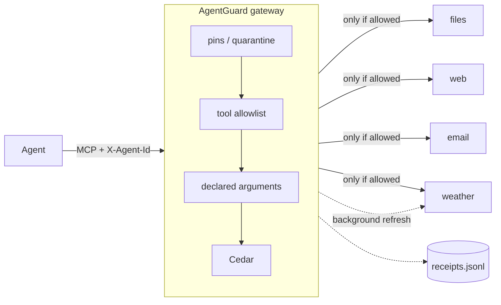
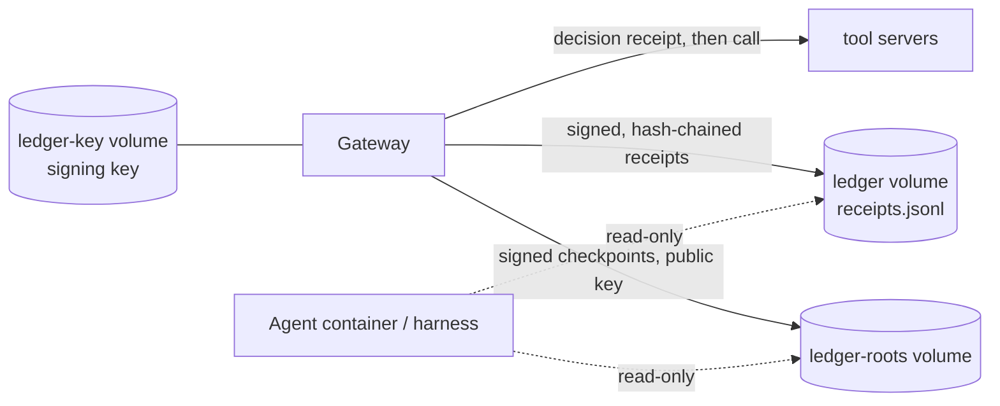

# Architecture

## Target (all phases)

Every tool call passes through the gateway, which checks who the agent is, whether this exact
action is allowed, and writes a signed receipt. Nothing reaches a tool without a decision.



## Phase 1: vulnerable baseline



- The agent reaches tools only through the URLs in `config/agent.baseline.yaml`. Phase 2 puts
  the gateway in front by switching to `config/agent.guarded.yaml`, which lists only the gateway.
- `agentguard.agent.toolbox.Toolbox` is the only MCP client. It serves both the LLM graph and
  the scripted driver, and records every call for the attack oracles.
- Tool servers run on an internal Docker network with no internet access. The files server
  maps `/` and `~` into the lab rootfs (`agentguard.labfs`). That is lab containment, not
  a security control: inside the lab the server is deliberately unrestricted.

## Phase 2: gateway and policy



`src/agentguard/gateway/proxy.py` is an MCP server (low-level `mcp.server.lowlevel.Server`, so
upstream schemas pass through unchanged) that is also an MCP client of every upstream.

**tools/call** runs the checks in order. The first one that doesn't allow the call ends it, and
any exception is a deny (`run_pipeline` in `gateway/checks.py`):

| Check | Denies when | Policy id in receipts |
| --- | --- | --- |
| `PinStore` | the tool's server is quarantined | `pin-quarantine` |
| `AllowlistCheck` | the tool isn't on the agent's list in `gateway.yaml`, or there's no agent id | `allowlist` |
| `ArgumentSchemaCheck` | an argument isn't declared in the pinned input schema | `undeclared-arguments` |
| `CedarCheck` | no Cedar policy permits it, a `forbid` matches, or the tool isn't in the schema | `@id` of the forbid, or `default-deny` |

Every decision, allow or deny, is written to `receipts.jsonl` with the agent, tool, argument
hash, policy id, decision time and a structured reason. Sensitive values in the reason are
salted commitments; see "Receipt exposure" below. Phase 5 turns this into the signed, hash-chained ledger.

**Cedar requests.** Principal `Agent::"<id>"`, action and resource `Action`/`Tool::"<tool>"`,
and a context built from the arguments by `build_context` in `policy/cedar.py`:

- File tools get `path`, normalized exactly as the files server will resolve it
  (`labfs.normalize`). So `/workspace/../home/agent/.ssh/id_rsa` is judged as the SSH key.
- `fetch_url` gets `url_scheme` and `url_host`.
- `send_email` gets `recipient` and `recipient_domain`.

Policies live in `config/policies/*.cedar` and are validated against
`schema.cedarschema` when the gateway starts. A tool missing from the schema gets `NoDecision`,
which is a deny.

**tools/list** returns the gateway's own verified copies of tool definitions, filtered by the
agent's allowlist and with quarantined servers removed. A changed upstream description
therefore never reaches the agent. A background loop (`refresh_interval_s`) re-fetches upstream
lists, pins new tools (trust on first use), and quarantines a server whose pinned tool changed.
Pins and quarantines persist in `pins.json`. To re-approve a server, stop the gateway and edit
that file. In Docker the file lives in the `lab-state` volume, so `docker compose down -v`
resets it.

Two details worth knowing:

- **The list handler must be cheap.** mcp 2's HTTP transport calls the server's own
  `tools/list` before every `tools/call`, to validate `Mcp-Param-*` headers. An early version
  refreshed upstreams inside the handler and added ~10 ms to every call.
- **Tool shadowing.** If two upstreams offer the same tool name, the first in `upstreams`
  wins and the other is logged and ignored.

**Identity** is the `X-Agent-Id` header in this phase, which is trivially forgeable. Phase 3
replaces it with DID-bound Biscuit tokens.

### Known gaps, tracked for later phases

- Nothing limits how often a tool is called (attack 6). Budgets and the kill switch come in
  Phase 4.
- `fetch_url` may reach any http(s) host, and results are not scanned. The egress allowlist
  and injection scanner come in Phase 4.
- A rug pull is detected only after the next refresh. Until then, calls to that server are
  still judged by the other checks.

### Receipt exposure (found in Phase 2, resolved in Phase 3 with option C)

**The finding.** In Phase 2, receipts hashed arguments, but denial `reason` strings quoted the
Cedar policy context in cleartext. For example:

```
no policy permits context {'recipient': 'attacker@evil.test', ...}
```

In addition, `upstream_error` recorded `repr(exc)`. Phase 5 hash-chains receipts, so this had
to be settled before the ledger commits to it.

**Now.** A reason is a structured record:

```json
{"rule": "default-deny", "summary": "no policy permits this call",
 "attributes": {"recipient_domain": "evil.test",
                "recipient": {"commitment": "0LPZlwZ4t_YUWYYfJkKuzVsj_F8oU4lxxjsE5sWn7-0"}}}
```

- **In the clear:** `recipient_domain`, `url_host`, `url_scheme`, and a `path_class`
  (`inside /workspace/tmp`, `inside /workspace` or `outside /workspace`). This is the
  `CLEAR_ATTRIBUTES` allowlist in `gateway/receipts.py`.
- **Committed:** every other attribute value, including the full recipient, the exact path
  and error messages. An attribute not on the allowlist is committed by default, so a new check
  can't leak a value by accident. Summaries carry no argument values.
- **`upstream_error`:** `{"exception": "<class>", "message": {"commitment": ...}}`, never
  `repr(exc)`.

**Commitments** (`gateway/commitments.py`) follow SD-JWT disclosures (RFC 9901). A value's
disclosure is `[salt, attribute, value]` in RFC 8785 canonical JSON, and its commitment is
`base64url(SHA-256(base64url(disclosure)))`. Each value gets a fresh random 128-bit salt, so
two denials for the same recipient produce different, unlinkable commitments.

**Where salts live, and who can read them.** Salts are written to a separate salt store, never
to the receipt log, and the file is created mode 0600.

| Lab | Salt store | Who can read it |
| --- | --- | --- |
| Docker | `/receipt-salts/salts.jsonl` in the `receipt-salts` volume, mounted **only into the gateway** | the gateway process; an auditor via `docker compose exec gateway`. The agent container, which reads receipts for the harness, cannot. |
| Local lab | `run-logs/<timestamp>/receipt-salts.jsonl`, next to `receipts.jsonl` for convenience | the local user |

Whoever holds the salts can prove, or recover by guessing, a committed value. Treat the salt
store as more sensitive than the receipts.

**Audit operations:**

- `agentguard receipts prove --receipts R --line N --attribute recipient --value V --salts S`
  prints `proven`, `mismatch` or `salt-deleted`. Exit code 0 means proven.
- `agentguard receipts forget --salts S --commitment D` deletes one salt. The value can then
  never be proven or recovered, while the receipt log stays byte-identical, so a Phase 5
  hash chain is unaffected.

**Reading results that need targets.** The LLM harness's "target existed" count takes targets
from its own call log, matched to receipts by `args_sha256` (`runlog.py`), not from receipts.

## Phase 5: audit ledger



**Change from the plan: JSON lines, not SQLite.** The plan's technology table says "Service +
SQLite". The ledger is a JSON-lines file instead. Tamper evidence comes from the hash chain,
signatures and checkpoints, not from the storage engine: an SQLite file can be edited as easily
as a text file. JSON lines keep the log readable with `jq`, need no extra service, and make
torn-write recovery a matter of bytes after the last newline.

Details: [phase5-design.md](phase5-design.md).
